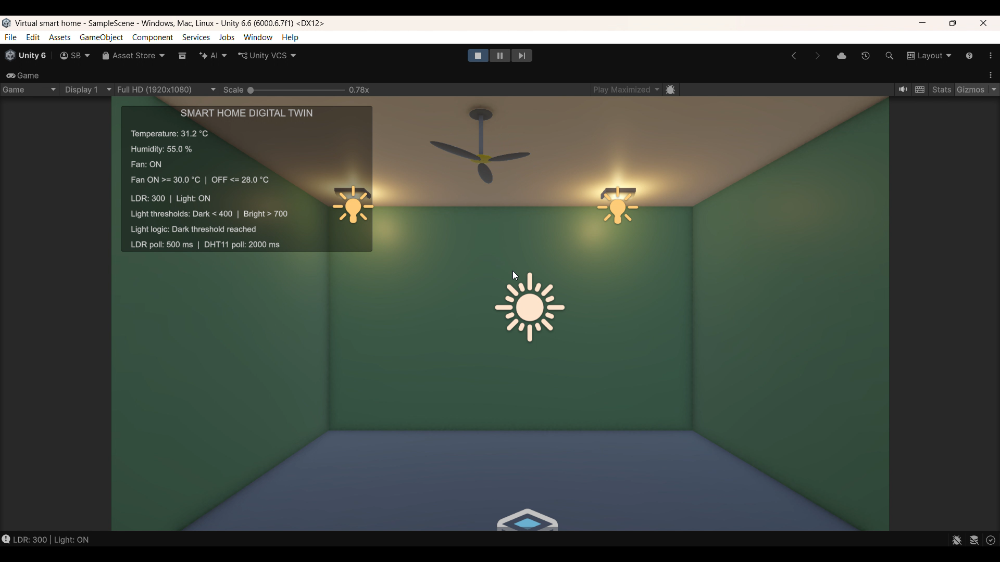
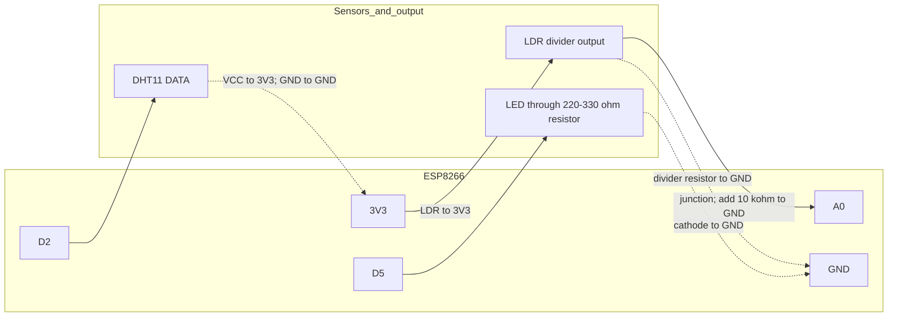

# Virtual Smart Home

Unity digital twin for an ESP8266. The scene polls `/data`: `fanState` drives the fan, and `lightState` switches all four room lights.

## Connect and run

1. Set `YOUR_WIFI_SSID` and `YOUR_WIFI_PASSWORD` in `arduino/fanlight.ino`, then flash the sketch and connect it to the same Wi-Fi as the computer running Unity.
2. Get the board IP from the Arduino Serial Monitor.
3. In `Assets/Scenes/SampleScene.unity`, set the same URL on both controllers: `http://<ESP8266-IP>/data`.
4. Press Play. `ESP OFFLINE` means the address or network connection needs checking.

## Wiring diagram

Use a 3.3 V compatible ESP8266 board. The divider orientation above makes the LDR reading lower in darkness; confirm your board's A0 voltage limit before wiring.

The provided sketch has no physical fan output pin. It only sends `fanState` to Unity; use a suitable transistor/MOSFET or relay driver and add a firmware output before connecting a real fan. Never power a fan directly from an ESP8266 GPIO.

## Sensor behavior

- LDR sampled every 500 ms: below 400 turns lights on; above 700 turns them off; between those values the previous state is kept.
- DHT11 sampled every 2 seconds: at or above 30 °C turns fan on; at or below 28 °C turns it off; between those values the previous state is kept.
- Unity displays LDR, temperature, humidity, and states from the JSON response. In the supplied sketch, `dark` is set to `lightState`; Unity does not use `dark`.

The sketch contains Wi-Fi placeholders; replace them locally and keep real credentials out of source control.
